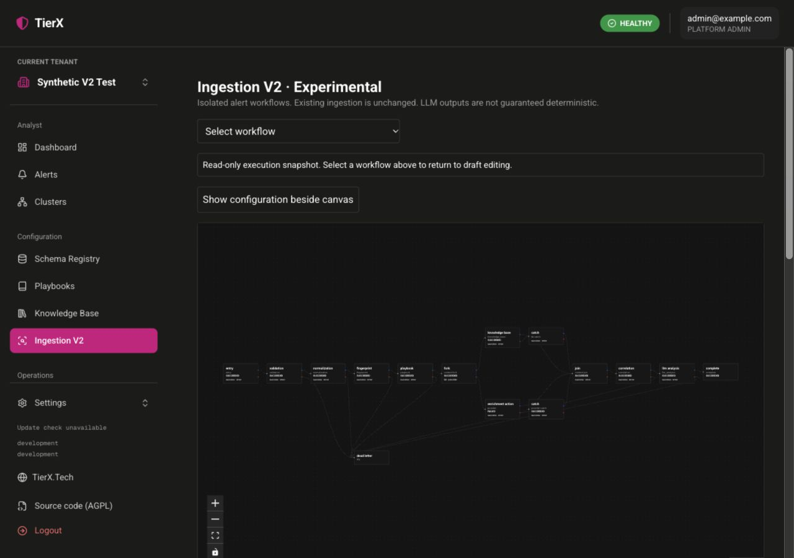

# TierX Ingestion V2 experimental workflows

Ingestion V2 executes tenant-owned alert workflows on the server. The React Flow
canvas edits configuration; it does not execute tools in the browser. V2 is
disabled by default and is intended for isolated local evaluation, not production
replacement of the existing ingestion pipeline.

## Isolation and permissions

Set `TIERX_INGESTION_V2_ENABLED=true` in the backend and separate workflow worker.
Without it, V2 endpoints return 404 and the worker exits. Existing ingestion,
Kafka consumers, Jira, and Alert Lab continue to use V1.

Platform and tenant administrators may edit, publish, bind, and submit workflows.
Tenant operators may inspect flows, runs, and cluster results. The tenant in the
authenticated path determines ownership; an alert cannot select another tenant.

V2 stores alerts, clusters, node jobs, deduplication ledgers, action batches,
requests, dead letters, and traces in tenant-local `v2_*` collections. Schemas,
playbooks, Knowledge Base documents, and authorized integrations are read from
the existing tenant configuration. The pipeline database adapter is inactive
outside the task-local V2 scope. Deduplication and correlation additionally use a
flow/revision cohort hash, so separate graph revisions do not group together.

## Local startup

Use a separate Compose project and unpublished local image builds. Do not reuse
a production MongoDB volume. From `examples/usage`:

```sh
node setup.mjs --release v0.0.0
# In the generated, gitignored .env set TIERX_INGESTION_V2_ENABLED=true.
# Choose a free localhost proxy port if another stack uses 8080.
export TIERX_APP_RELEASE_SHA="$(git rev-parse HEAD)"
docker compose -p tierx-v2-local --profile ingestion-v2 \
  -f compose.all-in-one.yaml -f compose.ingestion-v2.yaml \
  -f compose.ingestion-v2-build.yaml -f compose.ingestion-v2-model-build.yaml up -d --build
```

The build overlay replaces every application image with a local branch build;
`v0.0.0` is only a setup-helper placeholder, not a published release. Optional
semantic services still require their separate profile and approved embedding
model. For external Ollama, replace `compose.all-in-one.yaml` above with
`compose.external-ollama.yaml` and omit `compose.ingestion-v2-model-build.yaml`.

Complete the first-run installer and create an active synthetic tenant allowing
`SPLUNK`. Open that tenant's **Configuration → Ingestion V2** workspace. Create a
platform LLM profile first if the graph includes a model node. Test the profile,
authorize the tenant, then select its code in the node configuration. Profile
testing performs real inference and can take up to the configured timeout.



```sh
docker compose -p tierx-v2-local --profile ingestion-v2 \
  -f compose.all-in-one.yaml -f compose.ingestion-v2.yaml \
  -f compose.ingestion-v2-build.yaml -f compose.ingestion-v2-model-build.yaml logs -f workflow-v2
# Stop without deleting data:
docker compose -p tierx-v2-local --profile ingestion-v2 \
  -f compose.all-in-one.yaml -f compose.ingestion-v2.yaml \
  -f compose.ingestion-v2-build.yaml -f compose.ingestion-v2-model-build.yaml down
```

Never add `--volumes` unless deliberately deleting this disposable installation.
Generated deployment credentials stay outside Git. The proxy is the only
published service; MongoDB, ingestion, model services, and the worker are private.

## Drafts and published revisions

Save drafts with optimistic version checks. Validate before publishing an
immutable revision. Choose a default V2 binding, or an exact source-system and
alert-type override; exact bindings win. A binding must reference a published
revision. The test runner can execute a saved draft without changing a binding.

Import/export JSON format `1.0` includes nodes, edges, resource references,
positions, and viewport. It excludes credentials and execution history. Imported
flows are drafts. Replace unavailable schema, playbook, action, and profile IDs
in the configuration panel and validate before publishing.

Four templates are available:

- **Parity pipeline:** entry → validation → normalization → fingerprint →
  playbook → Knowledge Base → correlation → analysis → completion, with DLQ routes.
- **Parallel context with catch:** independent KB and registered-action branches,
  each with a replacement fallback, joined in declared order.
- **CIDR route:** typed containment of normalized source IP in `10.0.0.0/8`.
- **LLM tools:** approved evidence and KB tools before correlation and analysis.

Templates containing `local-analysis`, `local-tools`, or `example-context` require
matching authorized resources or explicit mapping. They do not create resources.
The parity template includes the common stages, not automatic execution of every
action listed on an existing playbook. Add explicit registered-action nodes for
the integrations this workflow should execute.

## Node configuration

Every processing node exposes success and error ports. Decisions expose true,
false, and error. Forks expose named branches; completion and dead-letter nodes
are terminal. Graphs must be acyclic and reachable, have one entry and a
completion, and contain at most 100 nodes and 300 edges. Forks require explicit
paired joins and two to five branches. Concurrent writes to the same canonical
stage are rejected; joins retain named branch results rather than implicitly
merging them.

| Node | Configuration |
| --- | --- |
| validation | `schema_id`, optional `schema_version`, or local `critical_fields` and `field_mapping` |
| normalization | schema reference or local `field_mapping` |
| fingerprint | optional `fields`, `window_hours` |
| playbook | optional `playbook_id`, `version`; otherwise active schema/type lookup |
| knowledge_base | optional `top_k`, `retrieval_mode`; default follows the playbook |
| enrichment_action | authorized `action_code` |
| correlation | optional bounded `lookback_hours`, `grouping_hours`, `debounce_ms` |
| llm_analysis | tested `profile_code`, optional prompt and output schema |
| llm_tools | profile, selected tools, prompt/schema, `max_rounds` ≤ 5, `max_calls` ≤ 10 |
| decision | `path`, `operator`, optional `value` |
| fork / join | ordered `branches` + `join_id` / matching `fork_id` |
| catch | object `replacement`, optional `output_schema` |

Normalization/fingerprinting/correlation/model nodes enforce required upstream
stages. Local overrides never update the original schema. Decision paths can
read `alert.normalized_payload` (nested or dotted ECS keys), prior `nodes`, and
safe error information. Operators are `eq`, `ne`, `exists`, `in`, `contains`,
`gt`, `gte`, `lt`, `lte`, and `cidr_contains`. No code or database expressions run.

A catch preserves the original failed job and records `handled_by` only after
its replacement satisfies the optional output schema. Replacement data is an
explicit node result, not an implicit rewrite of the alert. Decisions and later
tools may inspect it. An external action may also be used on an error branch.
Joins wait for every branch; unhandled failures take the join's error route.

## Execution and recovery

Authenticated ingestion returns 202 with alert and run IDs. A MongoDB scheduler
claims node jobs with conditional leases and 30-second heartbeats. Completed
jobs and model/tool round results are reused during recovery. Successor routing
uses deterministic identities and durable records. Five node executions may run
at once in the initial **single-worker** deployment; this is not a distributed
global limit.

Long calls may take up to the existing action timeout of 1–1800 seconds. Leases
are 1920 seconds and extend while running. A crashed worker's unfinished job can
remain waiting for that lease to expire. Provider delivery IDs are stable UUIDs;
providers must implement idempotent delivery handling. A crash after an external
effect or inference but before persistence can repeat the call. Exactly-once
external execution is not promised. Ordinary failed nodes follow their error
route; they are not automatically retried by a duplicate continuation.

Mandatory one-member clusters, severity debounce, 24-hour grouping, delta
versions, final closure, and stale-result checks reuse existing correlation
algorithms against isolated V2 storage. Cluster inference is coalesced per
requested version. Member runs wait for or reuse that version's result. Later
scheduled versions create linked continuations. Results remain under the V2
cluster summary, including prior summary history. No verdict or response action
is automatically executed.

The canvas shows persisted node states. Execution snapshots are read-only.
History and cluster pages expose outputs, safe errors, references, release
metadata, and timing. Run wall-clock duration is separate from individual active
node durations; parallel durations must not be summed as elapsed time.

## LLM profiles and data boundaries

Platform profiles support Ollama and OpenAI-compatible APIs. Provider credentials
are encrypted with the existing installation key, write-only, and excluded from
exports and run responses. Tested profile revisions are retained so execution
uses captured configuration. Disabling a profile or removing tenant permission
blocks future calls. HTTPS providers require explicit external-data permission;
HTTP is restricted to local/private Ollama development endpoints.

Analysis uses normalized evidence, existing playbook/system prompts, KB citations,
prompt budgets, and untrusted-evidence delimiters. Raw alert envelopes and
deployment secrets are not supplied. Native tool calling and JSON emulation are
explicit profile modes; there is no silent substitution. Only selected
`knowledge_base`, `alert_evidence`, `cluster_evidence`, and `action:<code>` tools
are available. Arguments are currently empty objects: the server supplies scoped
evidence and targets. Model-selected URLs, shell commands, and database queries
are rejected. Invalid calls, malformed responses, and budget exhaustion fail the
node and follow its error route.

Known credential fields, token strings, and credential-bearing URLs are redacted.
This is not general-purpose DLP: arbitrary secrets embedded in free text may not
be recognized. Use synthetic alerts/documents for this PoC. Model tags remain
operator-controlled and mutable; profiles record model name and revision but do
not yet pin a model digest. Changing the model behind a tag can change output.

## API entry points

All tenant paths use `/api/v2/tenants/{tenant_id}`:

- `GET /workflow-catalog`, `GET|POST /flows`, `PUT /flows/{flow_id}`
- `POST /flows/validate`, `POST /flows/import`, `GET /flows/{flow_id}/export`
- `POST /flows/{flow_id}/publish`, `GET /flows/{flow_id}/revisions`
- `GET|PUT /flow-bindings`, `GET /llm-profiles`
- `POST /ingest`, `GET /runs`, `GET /runs/{run_id}`
- `GET /clusters/{cluster_id}`

Profile APIs are under `/api/v2/admin/llm-profiles`. Refer to OpenAPI for exact
request/response models. V2 ingestion accepts `source_system`, `alert_type`,
`raw_payload`, and optional timestamp; tenant ownership is never a body field.
The authoritative event timestamp is resolved through normalization mappings.

## Verification and review boundaries

`examples/usage/smoke-workflows.mjs` runs against localhost only and creates a
synthetic tenant and flow. Supply disposable setup/admin values in environment
variables. It checks solo analysis, later correlation/delta summary history,
duplicate DLQ, and missing-field validation failure. An existing disposable
installation requires explicit `TIERX_V2_SMOKE_RESUME=true`.

Unit tests cover graph/condition validation, permissions, revisions, profiles,
scoped persistence, parallel joins/catch, lease recovery, concurrency, provider
adapters, redaction, tool budgets, and replay. Native protocol behavior is mocked;
the local model preflight and analysis path use real Ollama. Production scale,
multi-worker operation, exhaustive crash injection, real hosted-provider/native
tool capability, and 24-hour wall-clock soak testing remain review gates. No
remote release or deployment is part of this experimental branch.
